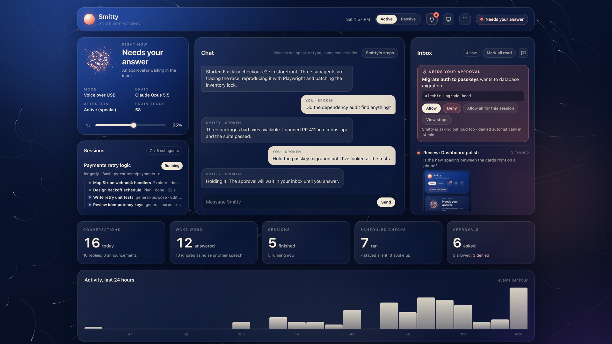
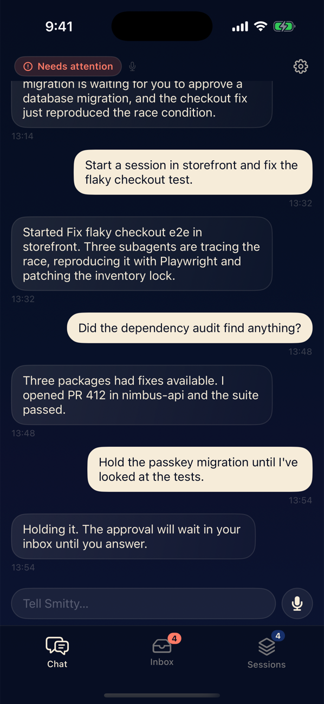
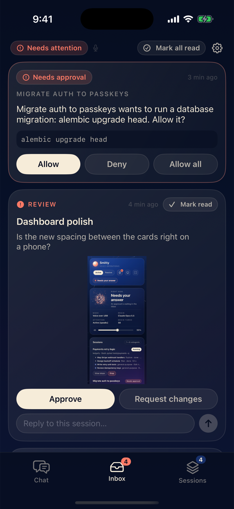
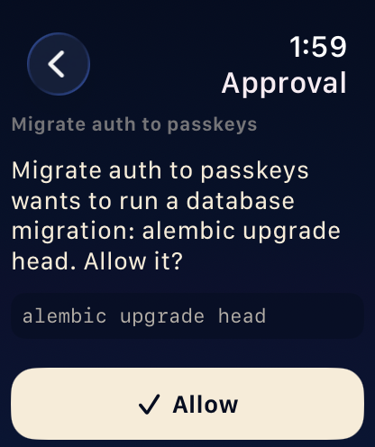
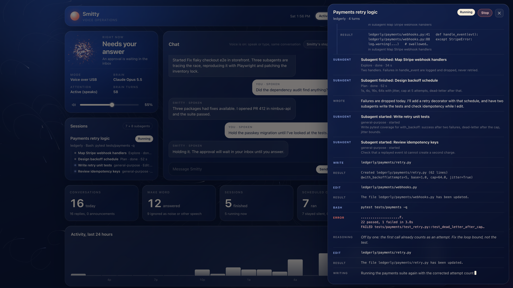

# Smitty

A voice assistant for your Mac that runs Claude Code for you. Say "hey Smitty, start a session in
the storefront project and fix the flaky checkout test" and it starts a real Claude Code session,
tells you when it is done, and asks you out loud before anything destructive happens. Speech
recognition, the wake word and the voice all run locally on the Mac; only the thinking goes to Claude.



- **Voice in, voice out.** Custom "hey Smitty" wake word, Whisper for speech to text, Kokoro for the
  voice, all on-device. A reSpeaker mic array handles echo cancellation so it can hear you while it talks.
- **Runs Claude Code sessions.** Start, resume, follow up on and stop sessions in any of your project
  folders, several at once. Each one is an ordinary Claude Code session you can also open in a terminal.
- **Asks before anything destructive.** Deleting files, `git push`, sending an email: the session
  stops and waits for your yes. This is enforced in code, not left to the model.
- **Works without the microphone.** A local dashboard gives you chat, an inbox, approvals and a live
  view of what every session is doing. Voice and typing are the same conversation.
- **Tasks and monitoring.** "Check my inbox every 15 minutes and only tell me about emails that need
  a reply." Scheduled jobs stay silent unless something needs you.
- **On the go (optional).** An iPhone and Apple Watch app to chat, read the inbox and approve actions
  while you are away from the Mac.

<p>
  
  
  
</p>

> **Before you run this:** Smitty starts Claude Code sessions that can edit files and run commands
> on your Mac, in your name. The approval gate catches the destructive actions it knows about; it
> is a safety net, not a sandbox. Read [Safety](#safety) first, and try it in a project you can
> afford to break.

## What you need

Only the first three rows are required. Everything else can be added later, one piece at a time.

| Part | Needed? | What it gives you | What you set up |
|---|---|---|---|
| Mac with Apple Silicon | **Required** | Whisper runs on MLX, which is Apple Silicon only | macOS, about 5 GB free for models and packages |
| [uv](https://docs.astral.sh/uv/) | **Required** | Installs Python 3.12 and the dependencies | `brew install uv` |
| Claude Code, signed in | **Required** | The brain and every session run through it | A Claude subscription (or an API key, see [Auth and billing](#auth-and-billing)) |
| Seeed reSpeaker XVF3800 (USB) + a speaker | Optional, needed for **voice** | Wake word, talking and listening, LED ring | Plug it in. `brew install libusb` for the LEDs |
| Tasks folder + claude.ai connectors | Optional | Email, calendar and Drive jobs, monitoring | Copy a template, authorize connectors at claude.ai |
| Claude Code hooks | Optional | Smitty announces and asks for sessions *you* started yourself | `uv run scripts/install_hooks.py` |
| Obsidian vault | Optional | "Note that..." adds to your notes | Point `SMITTY_VAULT_DIR` at the folder |
| Ego Lite browser | Optional | Sessions can use your signed-in browser | Install Ego Lite and its `ego-browser` skill, set the profile |
| iPhone / Apple Watch app | Optional | Chat, inbox and approvals away from the Mac | A free Supabase project, Xcode, an Apple ID |
| XIAO ESP32S3 Wi-Fi bridge | Optional, **experimental** | The mic array without a USB cable | Soldering, two firmware flashes |
| Your own wake word | Optional | A different name, or a model tuned to your room | `scripts/train_wakeword.py` |

Without the reSpeaker, Smitty still runs: you type in the dashboard instead of talking. The voice
code looks for the reSpeaker XVF3800 by name, so another microphone will not work without changing
`smitty/audio/usb.py`.

## Quick start (no hardware, about 10 minutes)

```bash
git clone https://github.com/Hteam121/smitty.git
cd smitty
uv sync                                    # Python 3.12 + dependencies (large: includes torch)
cp .env.example .env                       # then set SMITTY_USER_NAME and SMITTY_PROJECT_ROOTS
mkdir -p ~/Desktop/smitty-tasks/notes
cp templates/smitty-tasks/CLAUDE.md ~/Desktop/smitty-tasks/
```

Make sure Claude Code is installed and signed in (run `claude` once in a terminal and log in), then:

```bash
uv run smitty dashboard --demo             # just look around: the dashboard on sample data
uv run smitty run                          # the real thing; open http://127.0.0.1:8770
```

Type into the Chat panel: "what projects do I have?", then "start a session in <project> and
summarise the README". Smitty looks for projects in the folders listed in `SMITTY_PROJECT_ROOTS`
(default `~/Desktop`).

## Add voice

1. Plug the reSpeaker XVF3800 into the Mac over USB (the port next to the 3.5 mm jack) and connect
   a speaker to the board. Use the board for both the microphone and the speaker: its echo
   cancellation needs to know what is being played.
2. Download the speech models (about 2 GB: Whisper large-v3-turbo, Kokoro, Silero VAD):

   ```bash
   brew install libusb                      # LED ring
   uv run scripts/download_models.py
   ```

3. Check each stage, then run:

   ```bash
   uv run smitty devices                    # the reSpeaker should be listed
   uv run scripts/audio_check.py            # records 3 s and plays it back
   uv run smitty say "hello"                # the voice, through the board
   uv run scripts/selftest.py               # every stage on synthesized audio, no mic needed
   uv run smitty run                        # say "hey Smitty"
   ```

macOS will ask for microphone permission for your terminal the first time.

`smitty run` can be started before the board is plugged in: voice joins when the reSpeaker appears
and leaves when it is unplugged, and the conversation carries on in text either way.

### The wake word

`models/hey_smitty.onnx` is included, so "hey Smitty" works out of the box. It was trained only on
synthetic voices, so it may be more or less sensitive in your room: tune `SMITTY_WAKE_THRESHOLD`
(default 0.7, higher = stricter), or retrain. To use a different name:

```bash
uv run scripts/train_wakeword.py --phrase "hey computer"     # writes models/hey_computer.onnx
SMITTY_WAKE_MODEL=hey_computer SMITTY_WAKE_VERIFY=log uv run smitty run
```

Training synthesizes the phrase with Kokoro's 28 English voices plus about 110 negative sentences
(including hard negatives such as "hey Siri", "hey Smith", "the city"), augments the clips (speed,
gain, reverb, room noise recorded from the reSpeaker, babble), embeds them with openWakeWord's
frozen feature extractor and trains a small classifier exported to ONNX. Evaluation uses the macOS
`say` voices as a held-out engine. openWakeWord's own bundled models (for example `hey_jarvis`)
also work with `SMITTY_WAKE_MODEL` without training.

With any name other than Smitty, also deal with the second check: by default
(`SMITTY_WAKE_VERIFY=strict`) Smitty transcribes the audio that triggered the wake word and
ignores it unless the text sounds like "smitty". Either set `SMITTY_WAKE_VERIFY=log`, or change
`wake_verify_pattern` (and `assistant_name`) in `smitty/config.py` to match your name.

## Configuration

Settings are environment variables prefixed `SMITTY_`. Put them in `.env` (git-ignored, read at
startup) or export them in your shell, which wins. `.env.example` lists the common ones and
`smitty/config.py` has all of them with their defaults.

| Variable | Default | What |
|---|---|---|
| `SMITTY_USER_NAME` | `the user` | What Smitty calls you |
| `SMITTY_PROJECT_ROOTS` | `~/Desktop` | Colon-separated folders that hold your projects |
| `SMITTY_TASKS_DIR` | `~/Desktop/smitty-tasks` | Where non-coding jobs run |
| `SMITTY_AUTH` | `login` | `login` = claude.ai subscription, `api_key` = bill `ANTHROPIC_API_KEY` |
| `SMITTY_BRAIN_MODEL` / `SMITTY_BRAIN_EFFORT` | `claude-opus-5-5` / `low` | The model that talks to you |
| `SMITTY_WORKER_MODEL` | Claude Code's default | The model sessions run on |
| `SMITTY_AUDIO` | `usb` | `usb` or `websocket` (Wi-Fi bridge) |
| `SMITTY_WAKE_MODEL` / `SMITTY_WAKE_THRESHOLD` | `hey_smitty` / `0.7` | Wake word model and strictness |
| `SMITTY_WAKE_VERIFY` | `strict` | Double-check the wake word against the transcript; `log` or `off` to relax |
| `SMITTY_TTS` / `SMITTY_VOICE` | `kokoro` / `bm_george` | `say` forces the macOS built-in voice |
| `SMITTY_VOLUME` | `0.5` | 0 to 1; also adjustable by voice and in the dashboard |
| `SMITTY_ATTENTION` | `active` | `passive` = inbox only, never speaks on its own |
| `SMITTY_QUIET_HOURS` | off | e.g. `23-7`: hold scheduled results overnight |
| `SMITTY_VAULT_DIR` | (empty) | Your Obsidian vault folder; notes are off until it is set |
| `SMITTY_BROWSER_PROFILE` | `Default` | The one Ego Lite profile sessions may use |
| `SMITTY_HUB_URL` / `SMITTY_HUB_KEY` | off | Phone hub (or `~/.smitty/hub.json`) |
| `SMITTY_DASHBOARD` / `SMITTY_DASHBOARD_PORT` | on / `8770` | The local dashboard |
| `SMITTY_LEDS` | on | `0` leaves the LED ring alone |

Smitty keeps its own state (database, schedules, control token, screenshots) in `~/.smitty`
(`SMITTY_DATA_DIR`). Nothing personal is stored in this repository.

### Files you create locally (all git-ignored)

| File | For | Template |
|---|---|---|
| `.env` | Your settings | `.env.example` |
| `~/.smitty/hub.json` | Phone hub URL + secret key | `docs/hub-setup.md` |
| `apps/SmittyMobile/Local.xcconfig` | Your Apple team id and bundle id prefix | `Local.xcconfig.example` |
| `firmware/smitty_xiao/config.h` | Wi-Fi name, password, your Mac's address | `config.h.example` |

If you fork this and commit, keep it that way: never put a Wi-Fi password, a Supabase secret key
or your Apple team id in a tracked file.

## Commands

```bash
uv run smitty run                       # chat always on, voice whenever the reSpeaker is plugged in
uv run smitty run --brain echo          # wake word -> transcribe -> speak it back (no Claude)
uv run smitty chat                      # talk to the brain in the terminal; confirmations on stdin
uv run smitty serve                     # text only, even if the reSpeaker is plugged in
uv run smitty dashboard [--demo]        # the dashboard on its own
uv run smitty schedules                 # list scheduled tasks
uv run smitty devices                   # list audio devices
uv run smitty say "hello"               # speak through the board
uv run smitty shot <url>                # phone-sized screenshot with your own Chrome, headless
uv run smitty review <url> "question"   # ask yourself to look at a screenshot; prints your reply
uv run smitty hub [--check]             # phone hub sync on its own
uv run smitty ws-test                   # test the Wi-Fi audio link
```

Only one Smitty (`run`, `chat` or `serve`) runs at a time per data folder.

## Optional parts

### Email, calendar and Drive jobs

Non-coding jobs run as sessions in the tasks folder (set up in the quick start). They can use
whatever connectors your Claude account has: at claude.ai → Settings → Connectors, authorize
Gmail, Google Calendar and Google Drive. Then ask for things like "every weekday at 8, give me a
briefing: today's calendar, anything urgent in my inbox, and the weather". See
[Monitoring](#monitoring-inbox-calendar-anything-recurring). Schedules only fire while Smitty is running.

### Hooks for your own Claude Code sessions

`uv run scripts/install_hooks.py` adds three hooks to `~/.claude/settings.json` (backed up first,
existing hooks kept, `--remove` uninstalls) so Smitty can announce and ask about sessions you
started yourself in a terminal or the desktop app. With Smitty off, the hooks do nothing. Details
in [Claude Code hooks](#claude-code-hooks-your-own-sessions).

### Obsidian notes

Set `SMITTY_VAULT_DIR` to your vault folder. Until it is set, or if the folder does not exist, the
note tools are simply off. Smitty can add and read notes but cannot delete, rename or replace them. See
[Notes](#notes-obsidian).

### Your browser

Sessions can drive the Ego Lite browser, signed in as you, through its
`ego-browser` Claude Code skill (install the browser and the skill at user level as its own docs
describe, then set `SMITTY_BROWSER_PROFILE` to the id of the one profile sessions may use). If you
do not have it, leave it alone and do not ask Smitty for browser work.

Because that browser is signed in as you, the rules are strict and enforced in
`smitty/brain/browser.py`: payment, checkout, banking, ordering, card details, passwords and saved
sign-in data are refused outright and cannot be approved; anything that reaches another person or
changes something (send, post, reply, submit, book, upload, delete) asks you every time; reading and
searching are free.

### iPhone and Apple Watch

The phone never talks to the Mac directly. Both talk to a small Supabase project that you own, so
it works from anywhere and there is no port to open at home.

1. Create the hub and connect the Mac: [docs/hub-setup.md](docs/hub-setup.md) (about 10 minutes, free tier).
2. Build the apps: [apps/SmittyMobile/README.md](apps/SmittyMobile/README.md) (Xcode, `xcodegen`, your
   own bundle id and Apple team in `Local.xcconfig`).

A free Apple ID is enough for your own devices (re-install every 7 days); a paid developer account
removes that limit. Not built: push notifications. The app polls while it is open, so an approval
does not buzz your wrist on its own yet.

### Wi-Fi bridge (experimental)

A XIAO ESP32S3 soldered to the reSpeaker streams audio over Wi-Fi instead of USB. Playback works on
real hardware; the microphone direction is not proven yet. Do not start here. See
[firmware/README.md](firmware/README.md).

## Auth and billing

The brain and every session run through the Claude Code CLI bundled with the Agent SDK, so they
use whatever credential that CLI finds. By default Smitty removes `ANTHROPIC_API_KEY` and
`ANTHROPIC_AUTH_TOKEN` from its own environment at startup so your **claude.ai login** (your
subscription) is used. Set `SMITTY_AUTH=api_key` to bill an API key instead. Sessions count
against your Claude usage like any other Claude Code session, and a 15-minute monitor runs 96
sessions a day, so watch your limits. Everything else (wake word, VAD, Whisper, Kokoro) runs
locally and costs nothing.

## How it works: audio

```
AudioSource ─► openWakeWord ("hey smitty") ─► Silero VAD endpointing ─► mlx-whisper
                                                                           │
AudioSink  ◄── Kokoro TTS (fallback: macOS `say`) ◄── Brain (Claude Agent SDK) ◄┘
```

All audio goes through `smitty.audio.AudioSource` / `AudioSink` (16 kHz mono int16, 80 ms frames).
`smitty.audio.usb` is the reSpeaker-over-USB implementation; `smitty.audio.websocket` is the Wi-Fi
one. A new transport (another microphone, another board) is a new pair of those two classes.

## How it works: the brain

`smitty/brain/agent.py` is a Claude Agent SDK client with **no built-in tools** (`tools=[]`); it only
has the in-process MCP tools in the same file, such as `list_projects`, `list_sessions`,
`start_session`, `resume_session`, `stop_session`, `run_task` and `schedule_task`.

`smitty/brain/sessions.py` runs each Claude Code session as a worker (`ClaudeSDKClient` with `cwd` set
to the project, or `resume=<id>` for existing sessions, including ones started from the terminal or the
desktop app). When a worker finishes, the result is announced by voice.

### Spoken-yes gate

`smitty/brain/safety.py` classifies every worker tool call. Destructive ones (rm, git push, reset
--hard, sudo, publish, edits outside the project, MCP tools named delete/push/deploy/...) are caught by
a **PreToolUse hook**, which runs on every call regardless of the user's permission rules or mode, and
blocks until the user answers: a spoken yes, the Allow button on the approval card in the dashboard,
or an Allow tap in the phone or Watch app (the last two are the only way in passive or text-only mode). Anything that isn't a clear "yes" is a no,
and an approval nobody answers is denied after 15 minutes (`SMITTY_APPROVAL_WAIT_S`). The brain cannot
bypass this: it has no tools that touch files or shells, and no tool that answers an approval.

If Smitty's reply ends with a question, it keeps listening for a few seconds without a wake word.

## Tasks, schedules, weather

Non-coding jobs (email, calendar, Drive, research, drafts) run as worker sessions in
`~/Desktop/smitty-tasks` (`SMITTY_TASKS_DIR`), whose `CLAUDE.md` (copied from
`templates/smitty-tasks/`) sets the rules: final message spoken aloud, never send/delete/share without approval, keep recurring-check state in `notes/`.
Those sessions get whatever claude.ai connectors (Gmail, Google Calendar, Google Drive) you have
enabled at claude.ai → Settings → Connectors.

Brain tools: `run_task` (now), `schedule_task` (every N minutes, min 15; daily at HH:MM; once at a
datetime), `list_schedules`, `cancel_schedule`, `get_weather` (Open-Meteo, no key; remembers your
last location in `~/.smitty/state.json`). Schedules persist in `~/.smitty/schedules.json`, fire
only while Smitty runs (checked every 15 s), skip a run if the previous one is still going, and
announce each finished run by voice. `uv run smitty schedules` lists them. Each turn the brain is
told the current local date and time so relative times resolve correctly.


## Notes (Obsidian)

Smitty reads and adds to an Obsidian vault, which is just a folder of Markdown files. Point
`SMITTY_VAULT_DIR` at yours; notes stay off until you do.

Brain tools (`smitty/vault.py`): `add_to_daily_note` ("note that...": a timestamped line in today's
daily note, where Obsidian's own Daily notes button puts it), `create_note`, `append_to_note`,
`search_notes`, `read_note`. These only ever add: they cannot delete, rename or replace a note, and
cannot write outside the vault or into `.obsidian`.

Bigger jobs ("summarise this week's notes", "file this research into my vault") run as task sessions,
which get the vault as an extra working folder. There the spoken-yes gate applies: creating notes and
editing them is allowed, while deleting a note, replacing a whole note, or touching `.obsidian` asks
first. Coding sessions do not get the vault.

## Dashboard

Smitty records what it hears, says and does in a local SQLite database (`~/.smitty/smitty.db`,
`smitty/store.py`: an append-only `events` table, a `kv` table of latest snapshots, a `steps` table of
what each session did, and a `notices` table for the inbox). A small
local server (`smitty/dashboard/server.py`) serves one page
(`smitty/dashboard/index.html`) at **http://127.0.0.1:8770**:

```bash
uv run smitty dashboard          # on its own; works whether or not Smitty is running
uv run smitty dashboard --demo   # the same page on sample data (separate database)
```

It also starts automatically with `uv run smitty run`, `uv run smitty chat` and `uv run smitty serve` (`SMITTY_DASHBOARD=0`
to disable, `SMITTY_DASHBOARD_PORT` to move it). It shows the live state, today's counts, a 24-hour
activity chart, the activity feed (conversation, wake word accepted/ignored and what was heard,
sessions, schedules, approvals), open sessions, schedules with next run, and a systems list.
"Online" means Smitty's heartbeat in the store is under 15 seconds old. Nothing leaves the machine.

**Claude Code sessions Smitty did not start:** the Sessions panel also lists every Claude Code
session open on this Mac (terminal, desktop app, IDE) under "Claude Code on this Mac", with its
status (running, needs you, idle), latest tool call and running subagents. Click a row to follow its
steps live. These are view only: Stop and follow-ups stay limited to sessions Smitty started.
`smitty/claude_sessions.py` reads them from `~/.claude/sessions/<pid>.json` and the session
transcripts under `~/.claude/projects/`. Those files are Claude Code internals, not a documented
interface, so if a Claude Code update changes them the group simply shows nothing.

**Full-screen dashboard:** press `Shift+F` or the screen button in the top bar to show the whole
dashboard full screen, without the browser's tabs and address bar. `Esc` or `Shift+F` leaves.

**Smitty-only view:** press `F` or the corner-brackets button in the top bar to show only Smitty's
particle cloud over the flowing background (the cloud changes with the state: slow drift when idle,
drawn in when listening, fast swirl when thinking, ripples when speaking, coral when it needs you).
Moving the mouse briefly shows the name, the state and an exit button; `Esc` or `F` returns (to the
full-screen dashboard if that is where you came from).
`http://127.0.0.1:8770/?ambient` opens straight into it, e.g. for a spare display.

### Doing things from the dashboard

The page is also a control surface. Actions are forwarded to the running Smitty over a local control
channel (`smitty/control.py`: `/control/*` on port 8765, guarded by `~/.smitty/control.token`).

- **Chat.** Type to Smitty; the reply streams in as it is written and is not spoken. The panel shows
  the whole conversation, spoken and typed. "Smitty's steps" shows which tools it called for each request.
- **Inbox.** Finished sessions, scheduled checks that found something and failures land here as
  notifications. **Reply** continues the work: the reply goes straight to that session (resuming it if
  it has ended). **View steps** shows what the session did. The bell button turns on desktop alerts for
  when the tab is in the background.
- **Approvals.** A destructive action appears as a coral card with Allow / Deny / Allow all for this
  session, alongside the spoken question when Smitty is in active mode. First answer wins.
- **Sessions.** Each open session with its subagents (type, what it is doing, how long). View steps,
  Stop a running one, Close an idle one.
- **Schedules.** Run now, Pause / Resume, Remove (asks once more). Remove, Pause and Resume also work
  while Smitty is off; the page then edits `~/.smitty/schedules.json` directly.
- **Active / Passive** switch in the top bar (below).
- **Volume.** The slider on the Smitty card sets how loud Smitty speaks (0 to 100%, or mute). It applies
  when released, Smitty chimes once at the new level, and the level is remembered across restarts. By
  voice: "louder", "quieter", "volume to forty percent".

**Live steps.** Every session Smitty runs is a real Claude Code session driven through the Agent SDK
(the engine behind `claude -p`), with streaming on. `smitty/brain/stream.py` records each step to the
`steps` table: the prompt, a summary of the model's reasoning when it reasons, what it wrote, every tool
call and result, subagents starting and finishing, approvals, and the final result. Text and reasoning
appear word by word while they are produced. The same session can be opened in a terminal with
`claude --resume <id>` from the project folder (the id is shown at the bottom of the step view).



### Active and passive mode

- **Active** (default): results are spoken out loud and put in the inbox; approvals are asked by voice
  and shown in the dashboard.
- **Passive**: inbox only. Smitty says nothing on its own, so it will not talk over a call. A waiting
  approval pulses the LED ring red. It still answers when you say the wake word.

Switch with the top-bar control or by voice ("passive mode", "I'm on a call", "active mode"). Saying
"status check" makes Smitty read out what is new in the inbox and then ask any waiting approvals aloud.
`SMITTY_ATTENTION=passive` sets the mode used until you switch it. The logic lives in
`smitty/attention.py`. With `uv run smitty serve` there is no microphone, so everything goes to the inbox.

### Voice and text are one conversation

`uv run smitty run` starts the brain, scheduler, dashboard and chat straight away, with or without the
microphone. `smitty/voice.py` then watches for the reSpeaker: when it is plugged in, the speech models
load (first time only) and voice joins; when it is unplugged, voice leaves and Smitty carries on in text.
Nothing restarts, so the conversation continues across the change.

- Type and the reply is text. Speak and the reply is spoken. Both show in the chat, and a typed
  follow-up to something you said (or the other way round) keeps its context.
- Unplugged, everything goes to the inbox, as in passive mode. An approval that was being asked
  aloud when the plug was pulled stays open in the dashboard.
- Unplugging is noticed when no audio arrives for about 4 seconds; plugging in is noticed within about
  3 seconds. If the board is on the USB bus but offers no microphone (Wi-Fi firmware), the dashboard
  says so.
- With `SMITTY_AUDIO=websocket` the ESP32 link manages its own reconnects, as before.

Only one Smitty (`run`, `chat` or `serve`) runs at a time per data folder; a second one exits with a message.

## Monitoring (inbox, calendar, anything recurring)

A monitor is just a scheduled task whose prompt follows three rules, which the brain writes for you:
look only at what is new since the last run (state kept in `~/Desktop/smitty-tasks/notes/`), decide
what actually needs you, and reply `[silent]` otherwise. `[silent]` runs are not announced, so a
15-minute inbox check only speaks when a person is waiting on you. Set `SMITTY_QUIET_HOURS=23-7` to
hold scheduled results overnight; they arrive as one digest when quiet hours end, or ask "what did I
miss". Sending, replying or deleting always needs a spoken yes; monitors may only read and draft.

One-time setup: authorize **Gmail**, **Google Calendar** and **Google Drive** at claude.ai →
Settings → Connectors. Then say, or type into `uv run smitty chat`:

- "Check my inbox every 15 minutes and tell me only about emails that need a reply from me."
- "Every weekday at 8, give me a briefing: today's calendar, anything urgent in my inbox, and the weather."
- "Watch for a reply from Sarah about the contract and tell me the moment it arrives."
- "Ten minutes before each meeting today, remind me what it is and who's in it."
- "What schedules do I have?" / "Cancel the inbox check." / "What did I miss?"

## Switching the board between wire and Wi-Fi

Needs the firmware images from Seeed (see `firmware/README.md`). `scripts/flash_xvf3800.sh usb` puts the USB firmware back (Smitty over the cable, the default);
`scripts/flash_xvf3800.sh i2s` is for the XIAO Wi-Fi bridge. From I2S firmware the board must first
be in safe mode: hold Mute while plugging in its USB-C until the LED blinks red.

## LED ring

`smitty/led.py` drives the XVF3800's LED ring over its USB vendor control interface (pyusb +
Homebrew libusb; protocol from Seeed's `python_control/xvf_host.py`). States: idle = faint glow,
listening = cyan direction-of-arrival pointer, thinking = purple breathing, speaking = green
breathing, needs-confirmation = fast orange breathing, error = solid red. The previous ring
settings are restored on exit. `SMITTY_LEDS=0` disables it; `uv run scripts/led_check.py` cycles
every state for 2 s. Colours/speeds live in `PATTERNS` in `smitty/led.py`.

## Claude Code hooks (your own sessions)

`uv run scripts/install_hooks.py` adds three hooks to `~/.claude/settings.json` (backed up first,
existing hooks kept, `--remove` to uninstall). Each one pipes the hook JSON to
`scripts/claude-hook.sh`, which POSTs it to `http://127.0.0.1:8765/hook/<event>` and exits 0
silently if Smitty isn't running, so nothing changes when Smitty is off.

| Hook | What Smitty does |
|---|---|
| `Stop` | announces that the session finished, with a one-sentence summary |
| `PermissionRequest` | asks you by voice and returns allow/deny to Claude Code; no clear answer within ~40 s = no decision, so the normal dialog appears |
| `Notification` (`permission_prompt`, `idle_prompt`) | announces a pending approval it couldn't handle; idle announcements are off unless `SMITTY_ANNOUNCE_IDLE=1` |

Sessions Smitty started itself are ignored here (they're gated and announced in-process).
Also available: `GET /status` and `POST /say {"text": "..."}` for scripts.

## Layout

| Path | What |
|---|---|
| `smitty/cli.py` | the `smitty` command |
| `smitty/config.py` | every setting and its default |
| `smitty/pipeline.py` | state machine: idle → listening → thinking → speaking |
| `smitty/wake.py`, `vad.py`, `stt.py`, `tts.py` | wake word, end-of-speech detection, Whisper, Kokoro |
| `smitty/audio/` | `AudioSource` / `AudioSink` contract, USB and WebSocket implementations |
| `smitty/voice.py` | attaches the voice loop when the reSpeaker is plugged in, detaches when unplugged |
| `smitty/brain/agent.py` | the brain: a Claude Agent SDK client and its tools |
| `smitty/brain/sessions.py` | runs each Claude Code session as a worker |
| `smitty/brain/safety.py`, `browser.py` | what needs a yes, and what is refused |
| `smitty/brain/stream.py` | records each session's reasoning, tool calls and subagents |
| `smitty/attention.py` | active/passive mode, inbox, approvals by voice, dashboard or phone |
| `smitty/scheduler.py` | recurring and one-off tasks |
| `smitty/store.py` | SQLite store: events, snapshots, session steps, inbox |
| `smitty/dashboard/` | local dashboard server and its one page |
| `smitty/control.py` | token-guarded control channel the dashboard and hub use |
| `smitty/hooks_server.py` | localhost:8765 endpoint for Claude Code hooks |
| `smitty/hub.py` | sync with the Supabase hub for the phone |
| `smitty/led.py` | reSpeaker LED ring |
| `smitty/vault.py`, `weather.py`, `shot.py` | Obsidian notes, Open-Meteo weather, screenshots |
| `scripts/` | model download, wake word training, hardware checks, hook installer |
| `apps/SmittyMobile/` | iPhone and Apple Watch app (SwiftUI, no third-party packages) |
| `supabase/migrations/` | the hub's schema |
| `firmware/` | XIAO ESP32S3 sketch and flashing notes |
| `templates/smitty-tasks/` | the rules file for the tasks folder |
| `models/` | downloaded weights (git-ignored, except the trained wake word) |

## Safety

- **The gate.** Anything destructive a session tries (deleting files, `git push`, `reset --hard`,
  `sudo`, publishing, edits outside the project, connector tools that send or delete) is stopped by
  a PreToolUse hook until you say yes: spoken, clicked in the dashboard, or tapped on the phone or
  Watch. No clear yes means no. The brain has no tools that touch files or shells and none that can
  answer an approval.
- **What the gate is not.** It is a list of patterns for an honest model that makes a mistake or
  is misled by something it read. It is not a sandbox and it will not catch everything. Sessions
  otherwise run with edits auto-accepted in the project folder, with your user account's access.
  Use version control, and do not point it at folders you cannot restore.
- **Local only.** The dashboard and hooks endpoint listen on 127.0.0.1, reject requests from other
  sites, and reach the running Smitty through a token only your user account can read. With
  `SMITTY_AUDIO=websocket` the audio port (8766) listens on your network; use it on a network you trust.
- **What leaves the Mac.** Your transcribed requests and what sessions read go to Claude, as with
  Claude Code. Audio does not leave the Mac. If you set up the phone hub, your chat, inbox, session
  steps and review screenshots are mirrored to your own Supabase project.
- **The hub's secret key** gives full access to that project. It belongs in `~/.smitty/hub.json`
  only, never in the app and never in git. Turn off sign-ups in the hub after creating your account.

## Status

This is a personal project shared as-is, built for one desk and one person. Tested on an M4 Max
with the reSpeaker XVF3800 on USB firmware 2.1.1. Known gaps: no test suite beyond
`scripts/selftest.py`, the Wi-Fi microphone path, push notifications for the phone, and plugging
the board in and out while Smitty is running has had little real-world use. The Sessions panel's
view of Claude Code sessions Smitty did not start reads Claude Code's internal files and may stop
working after a Claude Code update.

Forks and pull requests are welcome.

## License

MIT, see [LICENSE](LICENSE). The speech models (Whisper, Kokoro, Silero VAD, openWakeWord) and
Seeed's firmware are downloaded separately and carry their own licenses.
